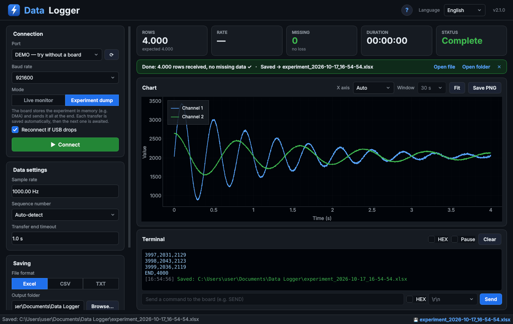
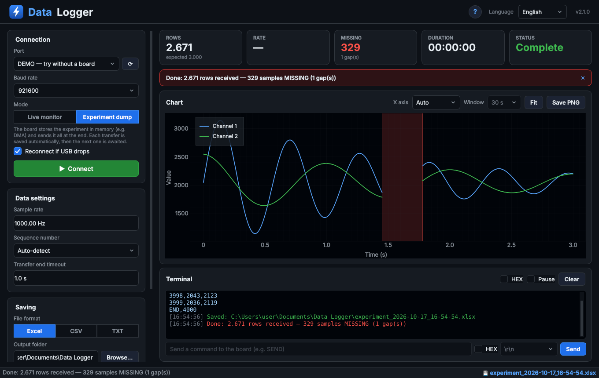
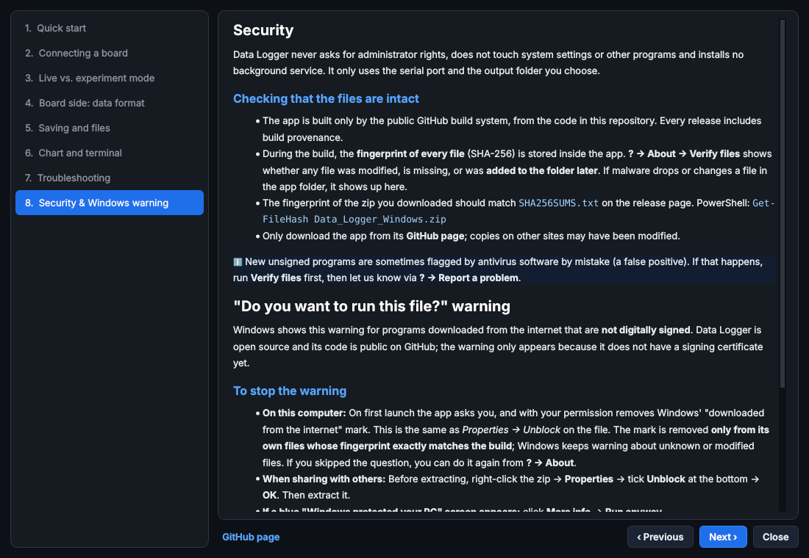

<p align="center">
  
</p>

<h1 align="center">Data Logger</h1>

<p align="center">
  <b>🇬🇧 English</b> · <a href="README.tr.md">🇹🇷 Türkçe</a>
</p>

<p align="center">
  Lossless serial data logger for <b>STM32, Arduino, ESP32</b> and any board that prints lines over a serial port.<br>
  Live chart, gap detection, and one-click export to <b>Excel / CSV / TXT</b>.
</p>

<p align="center">
  <a href="https://github.com/mhmtcndsgn/Data-Logger/releases/latest/download/Data_Logger_Windows.zip"></a>
  <a href="https://github.com/mhmtcndsgn/Data-Logger/releases/latest/download/Data_Logger_macOS.dmg"></a>
  <br>
  <a href="https://github.com/mhmtcndsgn/Data-Logger/releases/latest"></a>
  
</p>



---

## ✨ Features

- **Zero data loss.** Reading runs in its own thread and never waits on the disk or the screen, so high-speed bursts (e.g. a DMA buffer dumped at 921600 baud) arrive complete. Tested with a 300,000-line burst at ~125,000 lines/s.
- **Gap detection.** If the board sends a sequence number and `START,N` / `END,N` markers, every lost line is counted and highlighted in red on the chart.
- **Two modes**
  - **Live monitor:** data streams onto the chart as it arrives.
  - **Experiment dump:** the board records into memory and sends everything at the end; the app detects the end of the transfer, saves it automatically and waits for the next one.
- **Excel, CSV or TXT.** Excel files include a summary sheet (integrity, min/max/mean), the data and a chart. A raw backup of every received byte is kept as well.
- **Fast live chart** with zoom/pan and PNG export; 1 million points render in about a second.
- **Board detection:** STM32 (ST-Link), Arduino, ESP32, CH340, CP2102, FTDI and Raspberry Pi Pico ports are marked with ★.
- **Send commands** to the board (e.g. `SEND` to request a new dump), as text or **HEX bytes**; **↑ / ↓** recalls previous commands. A **HEX view** shows the raw bytes.
- **Auto-reconnect:** if the USB cable drops or the board restarts, the data received so far is saved and the app reconnects when the port is back.
- **Never loses a recording by accident:** asks before closing / reconnecting / opening a file when data is unsaved, writes files atomically (no half-written files), and splits very long live recordings every 1 million rows so memory never fills up.
- **Keyboard shortcuts:** F5 connect/disconnect · Ctrl+S save as · Ctrl+O open · Ctrl+L clear terminal · F1 guide.
- **English / Turkish** interface, settings are remembered (*? → Reset settings* if anything goes wrong).
- **DEMO port** to try everything without a board.
- **Built-in illustrated guide** (English / Turkish): click **?** or press **F1**. The same menu has *Check for updates*, *Report a problem / suggestion* and *About*.
- **No more Windows warning after the first launch:** the app offers once to remove Windows' "downloaded from the internet" mark (same as *Properties → Unblock*), but only from its own files whose fingerprint matches the build.
- **Verify files:** *? → About → Verify files* checks the SHA-256 fingerprint of every file in the app folder and reports modified, missing or unknown (added) files. See [Security](#-security).





---

## ⬇️ Install

### Windows 10 / 11
1. Download **[Data_Logger_Windows.zip](https://github.com/mhmtcndsgn/Data-Logger/releases/latest/download/Data_Logger_Windows.zip)**.
2. **Before extracting:** right-click the zip → **Properties** → tick **Unblock** at the bottom → **OK**.
   *This prevents the "Do you want to run this file?" / SmartScreen warning. The app is not code-signed yet (see [Code signing](#-code-signing-policy)). If you skip this, the app offers to remove the mark itself on first launch, so the warning appears only once.*
3. Extract and run **`Data_Logger.exe`**. Keep it next to its `_internal` folder.

### macOS (Apple Silicon, M1 and later)
1. Download **[Data_Logger_macOS.dmg](https://github.com/mhmtcndsgn/Data-Logger/releases/latest/download/Data_Logger_macOS.dmg)** and drag the app to **Applications**.
2. First launch: open the app once, then go to **System Settings → Privacy & Security** and click **Open Anyway** (on older macOS: right-click the app → **Open**).

### Verify your download (optional)
- Compare the file's SHA-256 with `SHA256SUMS.txt` on the release page: `Get-FileHash Data_Logger_Windows.zip` (PowerShell) or `shasum -a 256 Data_Logger_macOS.dmg`.
- Check that it was built by this repository's GitHub Actions: `gh attestation verify Data_Logger_Windows.zip -R mhmtcndsgn/Data-Logger`

---

## 🚀 Usage

1. Select the port (known boards are marked ★) and the same baud rate as your firmware.
2. Choose **Live monitor** or **Experiment dump** and click **Connect**.
3. Files are saved to `Documents\Data Logger` by default. **Open saved file…** reopens any earlier recording, including files from v1.

---

## 📡 Data format (board side)

The app understands all of these, one per line:

```
1450                      single value
12,345,678                multiple channels (comma, semicolon, space or tab)
Temp:25.3 Hum:60          named channels
time,adc1,adc2            header line (before data) → channel names
START,4000 / END,4000     start / end of a dump
```

**Recommended for loss detection:** a sequence number in the first column, plus `START,N` and `END,N`:

```
START,4000
0,2048
1,2051
...
3999,2040
END,4000
```

Ready-made examples:
- **STM32 (HAL):** [`firmware_ornek/veri_gonder.c`](firmware_ornek/veri_gonder.c): timer-triggered ADC + DMA + UART dump
- **Arduino / ESP32 / ESP8266:** [`firmware_ornek/arduino_ornek/arduino_ornek.ino`](firmware_ornek/arduino_ornek/arduino_ornek.ino): live mode, or a dump on the `GONDER` command

> ⚠️ **STM32 users:** if the ADC DMA runs in **Circular** mode while you transmit, the buffer wraps and overwrites old samples, which looks like "jumping" data. Use **Normal** mode and call `HAL_ADC_Stop_DMA` before sending.

---

## 🛠️ Run from source

```bash
pip install -r requirements.txt
python main.py
```
On Windows you can also double-click **`baslat.bat`**: it sets everything up on first run.

Tests: `pip install pytest && python -m pytest tests`

### Releasing a new version
1. Set `__version__` in `stm32logger/__init__.py` (e.g. `2.1.0`).
2. **Actions → Build Data Logger → Run workflow**, type the same version with a `v` (e.g. `v2.1.0`), then click **Run**.

Windows and macOS builds are tested automatically, published under **Releases** together with `SHA256SUMS.txt` and build provenance, and the download buttons above always point to the latest one. The workflow refuses to publish if the two versions differ.

### Project layout
```
main.py                     entry point
stm32logger/                application package
  engine.py                 lossless serial reader + DEMO port
  parser.py / session.py    line parsing, sequence / gap detection
  exporter.py / importer.py Excel / CSV / TXT
  help.py                   in-app guide texts (TR / EN)
  system.py                 file integrity, Windows unblock, update check, issue link
  ui/                       PySide6 + pyqtgraph interface
assets/help/                guide images (regenerate: python packaging/make_help_images.py)
firmware_ornek/             STM32 and Arduino/ESP32 examples
packaging/                  exe version info, file fingerprints (manifest), guide images
tests/                      tests (incl. a 300k-line stress test)
requirements-lock.txt       pinned, hash-checked dependencies for the build
SECURITY.md                 security policy and how releases are protected
```

---

## 🔒 Security

- Releases are built only by GitHub Actions from this repository, with pinned actions, hash-checked dependencies, a read-only token, SHA-256 checksums and signed build provenance.
- The app needs no administrator rights and never downloads or runs anything by itself.
- Data from the board is treated as untrusted (length / channel limits, formula-safe CSV/Excel export).
- Found a vulnerability? Please report it privately, see **[SECURITY.md](SECURITY.md)**.

---

## 🔏 Code signing policy

Windows builds are produced only by the public GitHub Actions workflow in this repository, from the source code in this repository. Free code signing through [SignPath Foundation](https://signpath.org) has been applied for. Until it is approved, releases are unsigned.

- **Committers and reviewers:** [mhmtcndsgn](https://github.com/mhmtcndsgn)
- **Approvers:** [mhmtcndsgn](https://github.com/mhmtcndsgn)

### Privacy policy
This program does not transfer any information to other networked systems unless specifically requested by the user. It only communicates with the serial device you select and writes files to the folder you choose. The only network request is made when you click **Check for updates**: it reads the latest version number from the GitHub API. **Report a problem** only opens a GitHub page in your browser; nothing is sent until you submit it yourself.

---

## 📄 License

[MIT](LICENSE) © 2026 Mehmet Can
