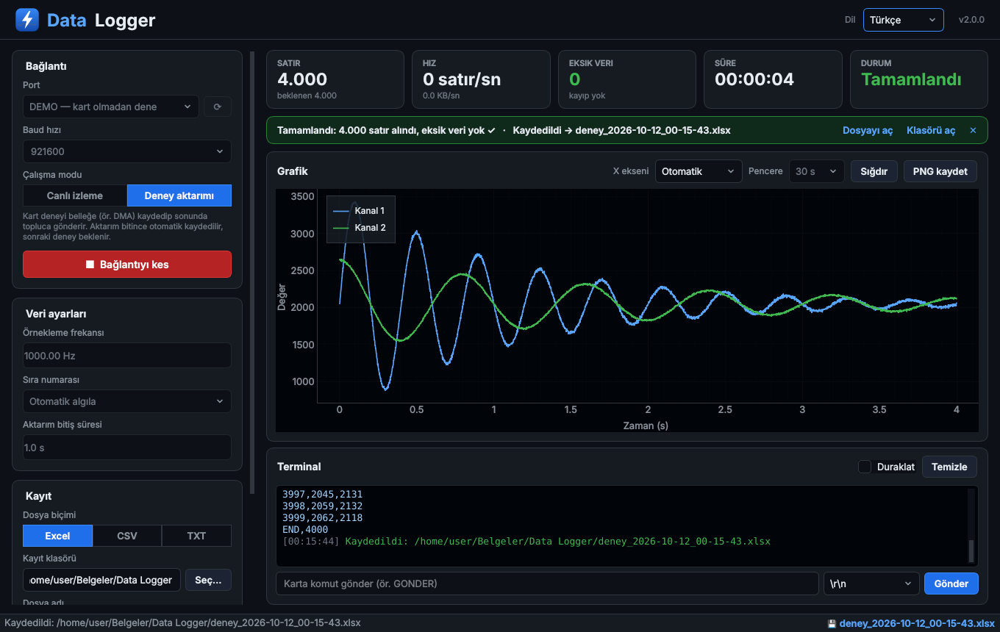
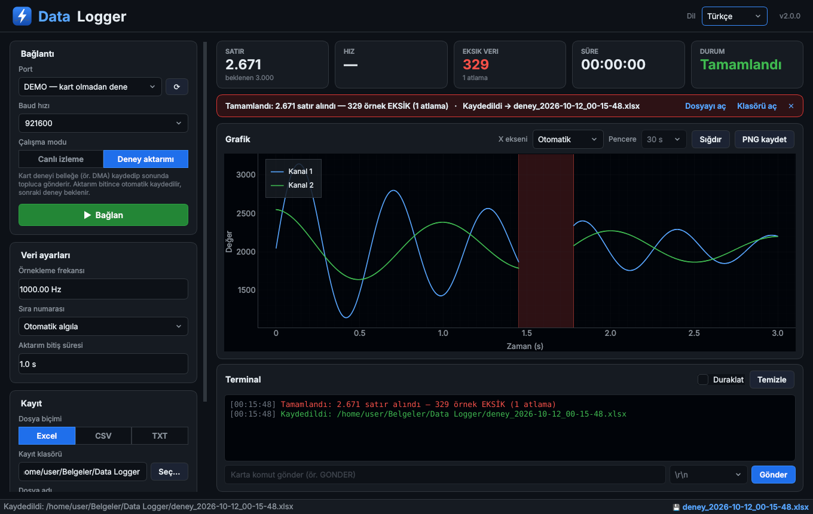

<p align="center">
  
</p>

<h1 align="center">Data Logger</h1>

<p align="center">
  <a href="README.md">🇬🇧 English</a> · <b>🇹🇷 Türkçe</b>
</p>

<p align="center">
  <b>STM32, Arduino, ESP32</b> ve seri porttan satır satır veri gönderen her kart için kayıpsız veri kaydedici.<br>
  Canlı grafik, kayıp veri tespiti ve tek tıkla <b>Excel / CSV / TXT</b> çıktısı.
</p>

<p align="center">
  <a href="https://github.com/mhmtcndsgn/Data-Logger/releases/latest/download/Data_Logger_Windows.zip"></a>
  <a href="https://github.com/mhmtcndsgn/Data-Logger/releases/latest/download/Data_Logger_macOS.dmg"></a>
  <br>
  <a href="https://github.com/mhmtcndsgn/Data-Logger/releases/latest"></a>
  
</p>



---

## ✨ Özellikler

- **Sıfır veri kaybı.** Okuma ayrı bir thread'de çalışır, diske ya da ekrana hiç beklemez. Bu yüzden yüksek hızlı toplu gönderimler de (örneğin 921600 baud'da gönderilen bir DMA tamponu) eksiksiz gelir. 300.000 satırlık tek parça aktarımla, saniyede yaklaşık 125.000 satır hızında test edildi.
- **Kayıp tespiti.** Kart sıra numarası ve `START,N` / `END,N` gönderirse kaybolan her satır sayılır ve grafikte kırmızıyla gösterilir.
- **İki mod**
  - **Canlı izleme:** veriler geldikçe grafikte akar.
  - **Deney aktarımı:** kart deneyi belleğe kaydeder ve sonunda topluca gönderir. Uygulama aktarımın bittiğini anlar, otomatik kaydeder ve sonraki deneyi bekler.
- **Excel, CSV ya da TXT.** Excel dosyasında özet sayfası (bütünlük, min/max/ortalama), veriler ve grafik bulunur. Ayrıca gelen her baytın ham yedeği tutulur.
- **Hızlı canlı grafik:** zoom, kaydırma ve PNG olarak kaydetme. 1 milyon nokta yaklaşık 1 saniyede çizilir.
- **Kart tanıma:** STM32 (ST-Link), Arduino, ESP32, CH340, CP2102, FTDI ve Raspberry Pi Pico portları ★ ile işaretlenir.
- **Karta komut gönderme** (örneğin yeni aktarım istemek için `GONDER`).
- **Türkçe / İngilizce** arayüz, ayarlar hatırlanır.
- **DEMO portu:** kart olmadan her şeyi deneyebilirsiniz.



---

## ⬇️ Kurulum

### Windows 10 / 11
1. **[Data_Logger_Windows.zip](https://github.com/mhmtcndsgn/Data-Logger/releases/latest/download/Data_Logger_Windows.zip)** dosyasını indirin.
2. **Zip'i açmadan önce** sağ tıklayın → **Özellikler** → alttaki **Engellemeyi kaldır** kutusunu işaretleyin → **Tamam**.
   *Böylece "Bu dosyayı çalıştırmak istiyor musunuz?" / SmartScreen uyarısı çıkmaz. Uygulama henüz dijital olarak imzalı değil (bkz. [Kod imzalama](#-kod-imzalama-politikası)).*
3. Zip'i çıkarın ve **`Data_Logger.exe`**'yi çalıştırın. Exe yanındaki `_internal` klasörüyle birlikte durmalı.

### macOS
1. **[Data_Logger_macOS.dmg](https://github.com/mhmtcndsgn/Data-Logger/releases/latest/download/Data_Logger_macOS.dmg)** dosyasını indirin, uygulamayı **Applications** klasörüne sürükleyin.
2. İlk açılışta uygulamaya sağ tıklayın → **Aç** (ya da **Sistem Ayarları → Gizlilik ve Güvenlik → Yine de Aç**).

---

## 🚀 Kullanım

1. Portu seçin (tanınan kartlar ★ ile işaretlidir) ve kart koduyla aynı baud hızını ayarlayın.
2. **Canlı izleme** ya da **Deney aktarımı** modunu seçip **Bağlan**'a basın.
3. Dosyalar varsayılan olarak `Belgeler\Data Logger` klasörüne kaydedilir. **Kayıtlı dosyayı aç…** ile eski kayıtlar (v1 dosyaları dahil) yeniden açılabilir.

---

## 📡 Veri biçimi (kart tarafı)

Uygulama her satırda şunların hepsini anlar:

```
1450                      tek değer
12,345,678                çok kanal (virgül, noktalı virgül, boşluk ya da tab)
Sicaklik:25.3 Nem:60      isimli kanallar
zaman,adc1,adc2           başlık satırı (veriden önce gelirse) → kanal adları
START,4000 / END,4000     aktarımın başı / sonu
```

**Kayıp tespiti için önerilen biçim:** ilk sütunda sıra numarası, başta `START,N`, sonda `END,N`:

```
START,4000
0,2048
1,2051
...
3999,2040
END,4000
```

Hazır örnekler:
- **STM32 (HAL):** [`firmware_ornek/veri_gonder.c`](firmware_ornek/veri_gonder.c): timer tetiklemeli ADC + DMA + UART gönderimi
- **Arduino / ESP32 / ESP8266:** [`firmware_ornek/arduino_ornek/arduino_ornek.ino`](firmware_ornek/arduino_ornek/arduino_ornek.ino): canlı mod ya da `GONDER` komutuyla deney aktarımı

> ⚠️ **STM32 kullananlar:** ADC'nin DMA'sı **Circular** modda çalışırken gönderim yaparsanız tampon başa dönüp eski verinin üzerine yazar. Bu da verilerin "kayması" gibi görünür. **Normal** modu kullanın ve göndermeden önce `HAL_ADC_Stop_DMA` çağırın.

---

## 🛠️ Kaynak koddan çalıştırma

```bash
pip install -r requirements.txt
python main.py
```
Windows'ta **`baslat.bat`** dosyasına çift tıklamanız da yeterli; ilk seferde gerekenleri kendisi kurar.

Testler: `pip install pytest && python -m pytest tests`

### Yeni sürüm yayınlamak
**Actions → Build Data Logger → Run workflow**'a tıklayın, sürüm kutusuna örneğin `v2.0.1` yazıp **Run**'a basın. Windows ve macOS sürümleri otomatik test edilip **Releases**'a eklenir. Yukarıdaki indirme butonları her zaman en son sürümü indirir.

---

## 🔏 Kod imzalama politikası

Windows sürümleri yalnızca bu repodaki herkese açık GitHub Actions iş akışıyla, bu repodaki kaynak koddan derlenir. [SignPath Foundation](https://signpath.org) üzerinden ücretsiz kod imzalama için başvuru yapıldı. Onaylanana kadar sürümler imzasızdır.

- **Geliştirici ve gözden geçiren:** [mhmtcndsgn](https://github.com/mhmtcndsgn)
- **Onaylayan:** [mhmtcndsgn](https://github.com/mhmtcndsgn)

### Gizlilik
Bu program hiçbir bilgiyi ağ üzerinden başka bir sisteme göndermez. Yalnızca seçtiğiniz seri cihazla haberleşir ve seçtiğiniz klasöre dosya yazar.

---

## 📄 Lisans

[MIT](LICENSE) © 2026 Mehmet Can
